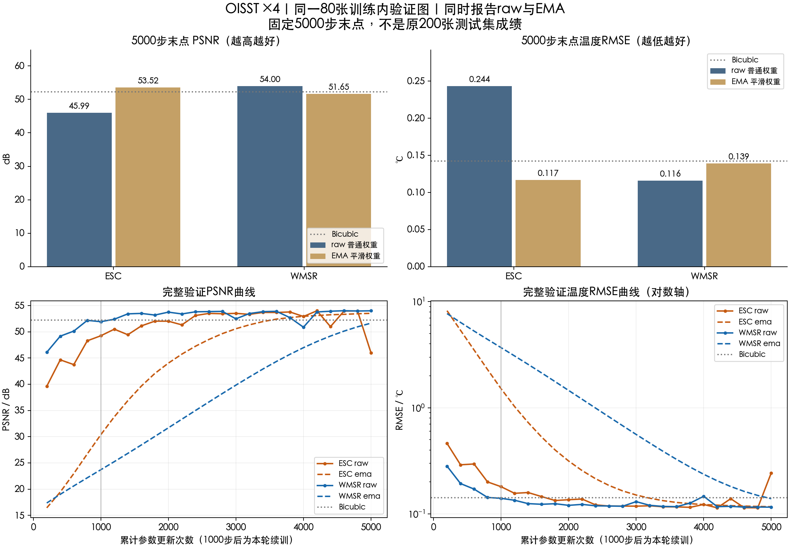

# SST Super-Resolution Experiments

海表温度超分辨率实验与模型对照。包含HYCOM、OISST、GHRSST的数据清单、训练配置、逐图指标、实验代码、结果表和可视化；另设SAFMN、CAMixerSR与BasicSR的基础超分模块。

截至2026-11-10，SST部分归档 **118项任务记录：110项完成、8项失败**。基础超分模块收录 **41条指标、25条验证记录、24份日志与Set5原图**。权重及续训断点按阶段提供在[Releases](https://github.com/yuanjuju/sst-super-resolution-benchmark/releases)。

## 从这里看

| 内容 | 入口 |
|---|---|
| SAFMN / CAMixerSR / BasicSR | [基础超分模块](foundations/natural-image-sr/README.md) · [基础实验工作簿](tables/natural_image_sr/experiments.xlsx) |
| 全部实验与结果 | [实验总览](docs/experiments.md) · [任务清单](tables/runs.csv) · [汇总工作簿](tables/sst_experiments.xlsx) |
| 200图测试结果 | [完整指标表](tables/test200_results.csv) · [方法比较与消融](tables/extended/) |
| 80图训练内验证 | [PFT、ESC与WMSR](tables/development80_results.csv) |
| 论文参考与实测 | [三方对照](tables/paper_reference/three_way.csv) · [原有工作簿](tables/paper_reference/three_way.xlsx) |
| 重建图、误差图、曲线 | [图表目录](figures/README.md) |
| 数据与训练设置 | [数据清单](data/README.md) · [实验协议](docs/protocols.md) |
| 代码与环境 | [运行说明](docs/running.md) · [上游版本](sources/versions.json) · [环境记录](environment/) |
| 权重和校验 | [下载说明](weights/README.md) · [文件索引](weights/manifest.csv) · [核验记录](checks/) |

## 最新一轮：ESC与WMSR各5000步

OISST ×4，720张拟合、80张训练内验证，seed10。两模型从1000步断点续训至5000步，使用相同AdamW、L1、EMA与有效batch8。

| 模型与参数 | PSNR / dB | RMSE / ℃ |
|---|---:|---:|
| ESC raw | 45.9947 | 0.24354 |
| ESC EMA | 53.5225 | 0.11703 |
| WMSR raw | 54.0029 | 0.11589 |
| WMSR EMA | 51.6466 | 0.13926 |

ESC的raw在末段出现波动，EMA更平稳。全部中间记录和固定5000步结果均保留。

测试实验使用固定800/200划分；PFT和ESC预实验使用训练集内720/80划分。论文参考值、两类实测结果分别列出。WMSR的24 WAM结构实现与公开4 WAM实现分别归档，具体结构和配方见各组config。

## 基础超分实验

[基础模块](foundations/natural-image-sr/README.md)按配置、数据、训练、测试、图表组织，提供Set5五对HR/LR、20张配对实验预测、5张固定样本对照、CPU推理结果和早期SAFMN 30k模型。

SAFMN两组各30k的FFT对照中，DIV2K EMA RGB PSNR为 **28.7956 / 28.7050 dB**，差值 **+0.0906 dB**。CAMixerSR单次5k验证为 **27.5543 dB**。配置和评测口径随记录列出。

[指标CSV](tables/natural_image_sr/) · [全部图表](foundations/natural-image-sr/figures/README.md) · [模型下载](foundations/natural-image-sr/weights/README.md)

## 原论文与模型

[WMSR论文](https://arxiv.org/abs/2509.24334) · [WMSR源码](https://github.com/oucailab/WMSR) · [MambaIR/MambaIRv2](https://github.com/csguoh/MambaIR) · [PFT](https://github.com/CVL-UESTC/PFT-SR) · [ESC](https://github.com/dslisleedh/ESC)

训练在云端完成，完整原始数据和环境留在云端；本仓库提供数据产品、下载地址、样本划分、哈希及数据构建脚本。
