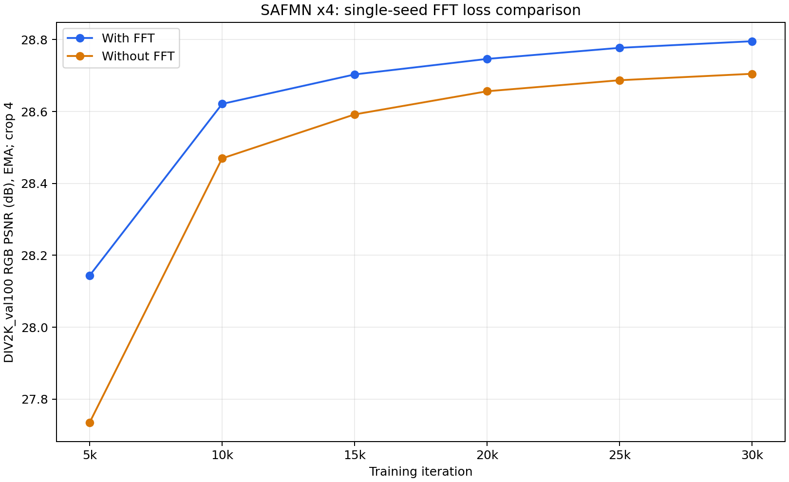

# 基础超分实验：SAFMN、CAMixerSR与BasicSR

自然图像×4实验，覆盖作者权重测试、从头训练、FFT损失对照和CPU单图推理。

## 结果

| 实验 | 评测 | PSNR / dB |
|---|---|---:|
| SAFMN作者权重 | Set5 / Y / params | 32.1836 |
| CAMixerSR作者权重 | Set5 / Y / params_ema | 32.5533 |
| SAFMN早期30k | DIV2K val100 / RGB / EMA | 28.7915 |
| CAMixerSR 5k | DIV2K val100 / RGB / EMA | 27.5543 |
| SAFMN配对30k：L1+0.05 FFT | DIV2K val100 / RGB / EMA | 28.7956 |
| SAFMN配对30k：L1 | DIV2K val100 / RGB / EMA | 28.7050 |

各项裁边4。配对实验使用同一RTX5090、batch64、seed10和共同初值，FFT组在30k时领先0.0906 dB。不同训练阶段按各自设置列出。

## 按功能查看

| 内容 | 入口 |
|---|---|
| 实验过程与设置 | [四项实验主题](studies/README.md) · [配置](configs/README.md) |
| 全部测试与指标 | [原指标表](results/metrics.csv) · [整理后的表格](../../tables/natural_image_sr/) |
| 曲线与效果图 | [图表目录](figures/README.md) · [汇总工作簿](../../tables/natural_image_sr/experiments.xlsx) |
| 数据 | [Set5原图与训练数据下载](data/README.md) |
| 脚本 | [数据、环境、预检、训练、评估](scripts/README.md) |
| 本地推理 | [学习脚本](learning/README.md) · [全部已保存输出](results/local-inference/) |
| 模型文件 | [SAFMN 30k权重与状态下载](weights/README.md) |
| 核对结果 | [来源清单](checks/publication_provenance.json) · [核验记录](checks/verification.json) |



## 本地运行

从本模块目录执行；依赖安装到本模块的`.venv`：

```bash
python3 -m venv .venv
.venv/bin/python -m pip install -r learning/requirements.txt
gh release download natural-image-sr-v2026.11.10 \
  --repo yuanjuju/sst-super-resolution-benchmark --dir downloads
.venv/bin/python learning/02_infer_image.py \
  --input datasets/Set5/LR_bicubic/X4/bird.png \
  --gt datasets/Set5/HR/bird.png --weight-key params_ema
```

云端配置保留原实验路径`/root/fsas/sr-repro`，部署位置见脚本索引。基础训练为单次5k/30k实验，Set5指标按五图平均。

材料整理自[sr-training-workbench](https://github.com/yuanjuju/sr-training-workbench)，来源版本和逐文件哈希见checks。网络作者与数据来源见[第三方说明](THIRD_PARTY.md)。
