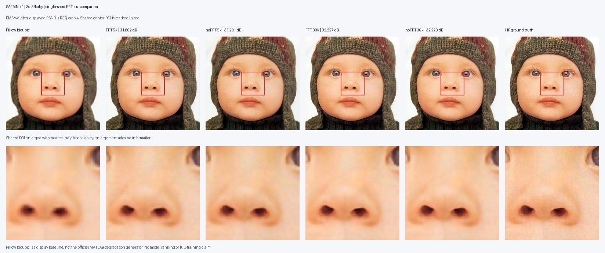
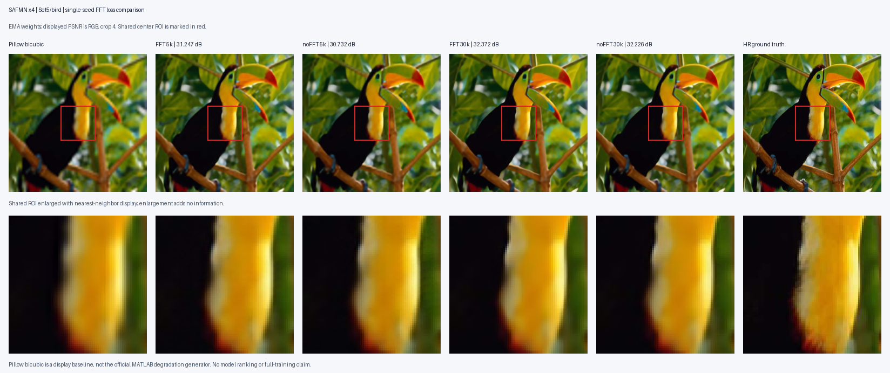
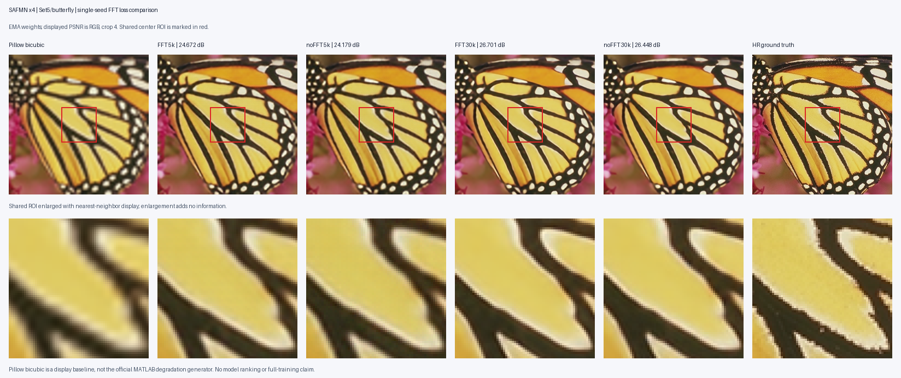
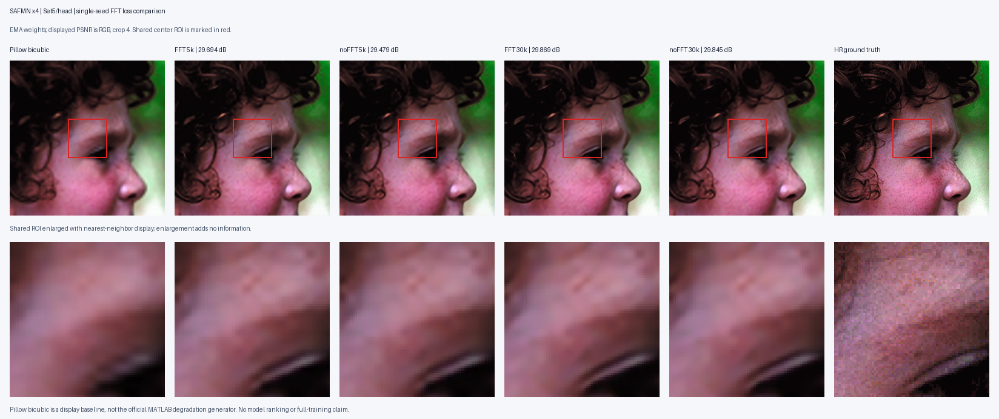
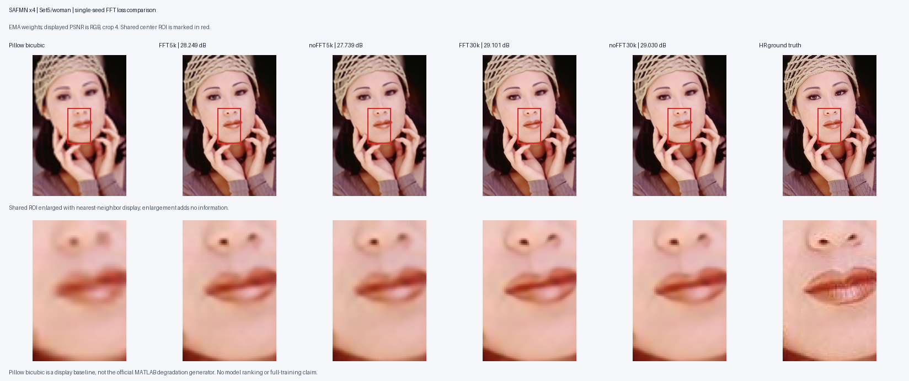
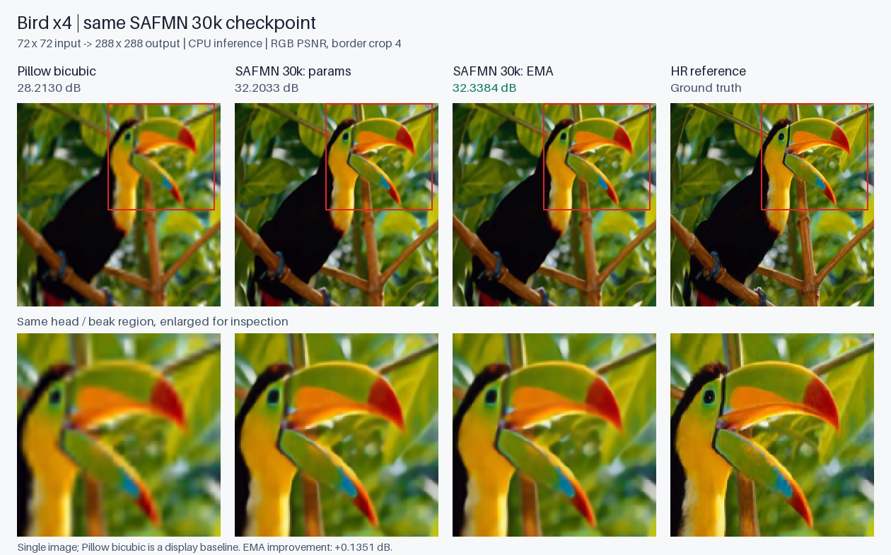

# 基础超分图表

## 训练与测试

- [FFT配对训练曲线](../results/safmn_fft_pair_30k/results/training_curve.png)
- [Excel指标与可编辑曲线](../../../tables/natural_image_sr/experiments.xlsx)
- [全部图像与指标目录](../../../tables/natural_image_sr/)

## Set5固定样本对照

每张图比较FFT/无FFT在5k与30k的输出。

| baby | bird |
|---|---|
|  |  |
| butterfly | head |
|  |  |

[20张独立预测](../results/safmn_fft_pair_30k/results/predictions/) · [早期四组butterfly预测](../results/legacy-set5-predictions/)

## CPU推理与EMA

[bird全部输出](../results/local-inference/) · [butterfly单图对照](../learning/examples/butterfly_30k/comparison.png)
